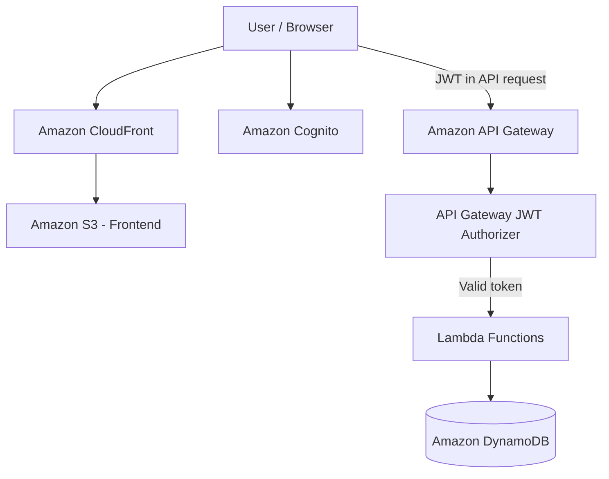
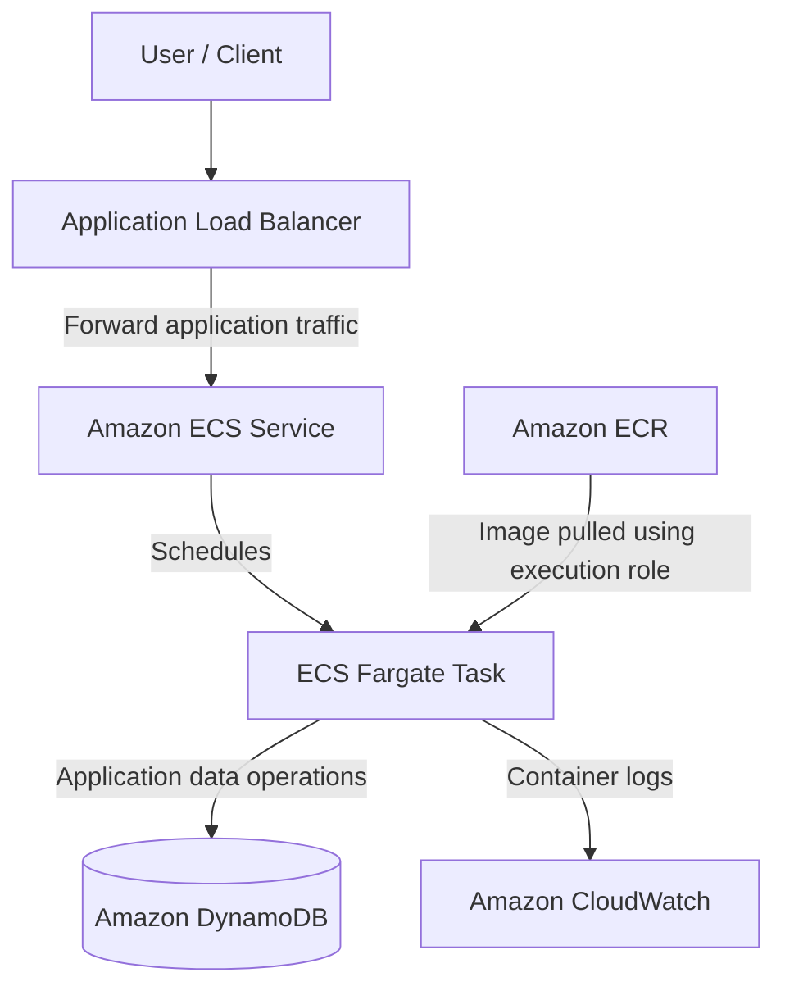
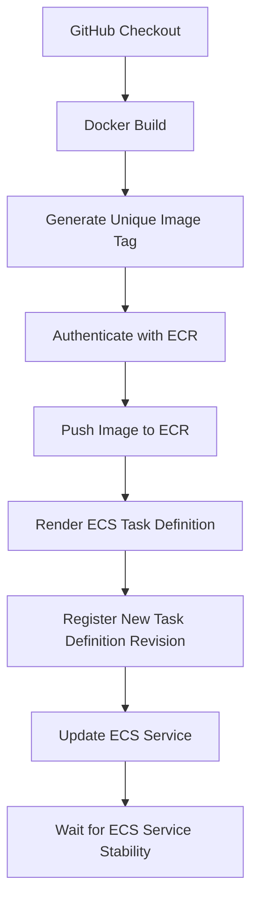
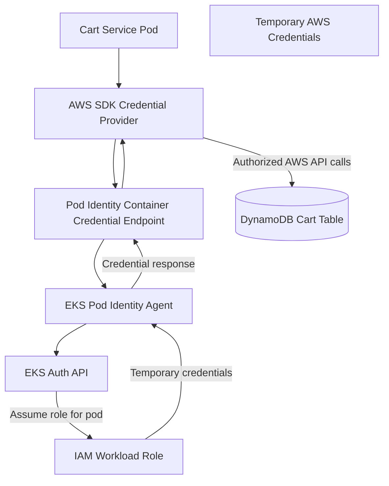
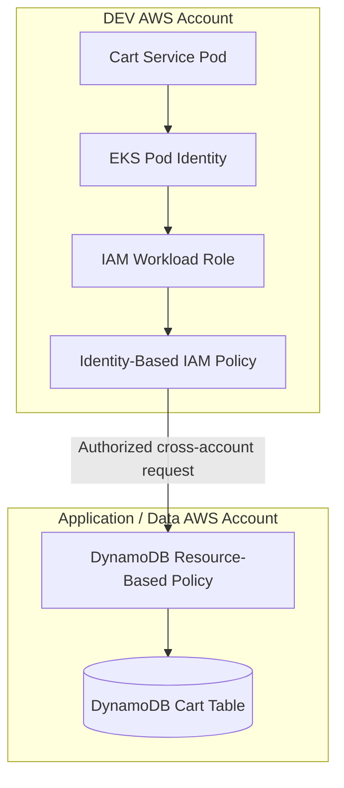
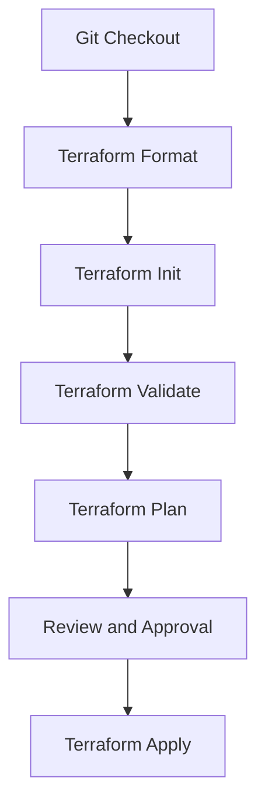

# E-Commerce DevSecOps Platform on AWS

**Serverless → Microservices → ECS Fargate → EKS → Kubernetes → DevSecOps → GitOps**

A hands-on cloud engineering project focused on building, migrating, automating and securing an e-commerce application using Amazon Web Services (AWS), Terraform, Docker, Jenkins, ECS, EKS, Kubernetes and DevSecOps practices.

The project demonstrates the evolution of an application from a serverless architecture into containerized microservices, with infrastructure automation, CI/CD pipelines, IAM security, container vulnerability scanning and Kubernetes-based deployment strategies.

The objective is to gain practical experience in cloud infrastructure engineering, application modernization, deployment automation, security integration, troubleshooting and operational practices.

---

## Table of Contents

1. [Technology Stack](#1-technology-stack)
2. [Project Evolution](#2-project-evolution)
3. [Serverless E-Commerce Architecture](#3-serverless-e-commerce-architecture)
4. [Dockerization and Microservices Migration](#4-dockerization-and-microservices-migration)
5. [AWS ECS Fargate Migration](#5-aws-ecs-fargate-migration)
6. [Terraform Infrastructure as Code](#6-terraform-infrastructure-as-code)
7. [Amazon EKS and Kubernetes](#7-amazon-eks-and-kubernetes)
8. [EKS Pod Identity and Workload IAM](#8-eks-pod-identity-and-workload-iam)
9. [Cross-Account AWS Access](#9-cross-account-aws-access)
10. [Jenkins CI/CD and DevSecOps Automation](#10-jenkins-cicd-and-devsecops-automation)
11. [DevSecOps and Container Security](#11-devsecops-and-container-security)
12. [Testing and Quality Assurance](#12-testing-and-quality-assurance)
13. [Deployment, Rollback and Recovery](#13-deployment-rollback-and-recovery)
14. [Monitoring and Security Operations](#14-monitoring-and-security-operations)
15. [Repository Structure](#15-repository-structure)
16. [Key Engineering Concepts](#16-key-engineering-concepts)
17. [Future Roadmap](#17-future-roadmap)
18. [Project Status](#18-project-status)

---

## 1. Technology Stack

| Category | Technologies |
|---|---|
| Cloud Platform | Amazon Web Services (AWS) |
| Programming | Python |
| Backend Framework | Flask |
| Serverless | AWS Lambda |
| API Management | Amazon API Gateway |
| Authentication | Amazon Cognito |
| Database | Amazon DynamoDB |
| Infrastructure as Code | Terraform |
| Containerization | Docker |
| Container Registry | Amazon ECR |
| Container Orchestration | Amazon ECS, AWS Fargate, Amazon EKS |
| Container Platform | Kubernetes |
| CI/CD | Jenkins |
| Source Control | Git, GitHub |
| Static Application Security Testing | Semgrep |
| Container Vulnerability Scanning | Trivy |
| Monitoring and Observability | CloudWatch, New Relic |
| GitOps | Argo CD |
| MLOps | Amazon SageMaker (future exploration) |

**Implementation note:** This technology stack includes both implemented technologies and technologies planned for future phases. Their implementation status is identified throughout this README.

---

## 2. Project Evolution

The project started as a serverless e-commerce application and progressively evolved into a cloud-native DevOps platform.

Different deployment architectures are maintained to understand their advantages, limitations and operational requirements.

| Phase | Architecture / Technology | Objective |
|---|---|---|
| 1 | AWS Serverless | Build an e-commerce backend |
| 2 | Terraform | Automate serverless infrastructure |
| 3 | Docker | Containerize the cart service |
| 4 | AWS ECS Fargate | Migrate the cart service to containers |
| 5 | Jenkins | Automate ECS deployments |
| 6 | Terraform Modules | Build reusable infrastructure |
| 7 | AWS EKS | Develop Kubernetes infrastructure |
| 8 | Kubernetes | Deploy and manage containerized workloads |
| 9 | Semgrep and Trivy | Integrate security into CI/CD |
| 10 | Argo CD | Implement GitOps |
| 11 | New Relic | Improve application observability |
| 12 | Amazon SageMaker | Explore MLOps |

---

## 3. Serverless E-Commerce Architecture

The initial application was developed using AWS serverless services.

### Architecture



### Authentication and Backend Flow

1. The user accesses the frontend through Amazon CloudFront.
2. The frontend is delivered from Amazon S3.
3. Amazon Cognito authenticates the user.
4. Cognito issues JWT tokens after successful authentication.
5. The frontend includes the JWT in API requests.
6. Amazon API Gateway's JWT authorizer validates the token.
7. Authorized requests are forwarded to the relevant Lambda function.
8. Lambda functions interact with Amazon DynamoDB.

**Important:** API Gateway validates JWTs using the configured issuer and public signing keys. It does not need to make a Cognito authentication API call for every incoming request.

### AWS Services

| Service | Responsibility |
|---|---|
| Amazon S3 | Static frontend hosting |
| Amazon CloudFront | Content delivery |
| Amazon Cognito | User authentication |
| Amazon API Gateway | API management |
| AWS Lambda | Serverless application logic |
| Amazon DynamoDB | Application data storage |
| Amazon CloudWatch | Logging and monitoring |
| AWS IAM | Identity and access management |

### Authentication

Implemented Amazon Cognito authentication using:

- Authorization Code Flow.
- PKCE (Proof Key for Code Exchange).
- JWT-based authorization.
- API Gateway JWT authorizer.

### Lambda Microservices

The application contains the following Python Lambda functions:

| Function | Responsibility |
|---|---|
| `getProducts` | Retrieve product information |
| `getProduct` | Retrieve individual product information |
| `addToCart` | Add products to the shopping cart |
| `getCart` | Retrieve shopping cart information |
| `checkoutCart` | Process checkout |
| `getOrders` | Retrieve order history |

### Terraform Infrastructure

The original serverless infrastructure was managed using Terraform.

```text
infra/
├── api.tf
├── cloudfront.tf
├── cognito.tf
├── lambda.tf
├── main.tf
├── provider.tf
├── s3.tf
└── variables.tf
```

---

## 4. Dockerization and Microservices Migration

The next phase involved moving from a serverless-only backend toward containerized microservices.

The cart service was selected as the first service for containerization.

The migration was incremental, allowing the original serverless implementation to remain separate.

### Cart Service Technology Stack

- Python
- Flask
- Docker
- Gunicorn
- Boto3
- PyJWT
- Flask-CORS
- Pydantic
- Amazon DynamoDB

### Application Structure

```text
services/
└── cart-service/
    ├── Dockerfile
    ├── app.py
    ├── requirements.txt
    ├── tests/
    │   └── test_app.py
    ├── valid_products.json
    ├── invalid_products.json
    └── validate_data.py
```

The Flask application was containerized using Docker and configured to run using Gunicorn.

The service integrates with DynamoDB for cart-related operations.

---

## 5. AWS ECS Fargate Migration

The Dockerized cart service was migrated to Amazon ECS Fargate.

This introduced container orchestration, managed container compute, load balancing and automated deployments.

### ECS Architecture



### Architecture Explanation

- The Application Load Balancer receives application traffic.
- The ECS service maintains the desired number of running tasks.
- ECS schedules the cart-service container on AWS Fargate.
- The task execution role allows the container image to be pulled from ECR and supports configured logging.
- The application task role provides the permissions required by the running application.
- The application communicates with DynamoDB.
- Container logs are sent to CloudWatch.

### AWS Services

| Service | Responsibility |
|---|---|
| Amazon ECR | Container image registry |
| Amazon ECS | Container orchestration |
| AWS Fargate | Serverless container compute |
| Application Load Balancer | Application traffic routing |
| Amazon CloudWatch | Container logging |
| Amazon DynamoDB | Application data |
| AWS IAM | Task and deployment permissions |

### ECS Infrastructure as Code

The ECS infrastructure was managed using Terraform.

```text
ecs-infra/
├── alb.tf
├── cloudwatch.tf
├── cloudtrail.tf
├── dynamodb.tf
├── ecr.tf
├── ecs.tf
├── iam.tf
├── jenkins-iam.tf
├── locals.tf
├── network.tf
├── outputs.tf
├── provider.tf
├── secrets.tf
├── variables.tf
└── backend-bootstrap/
    └── main.tf
```

### Infrastructure Implementation

- Created an ECS cluster.
- Configured an ECS Fargate service.
- Created an Application Load Balancer.
- Created an Amazon ECR repository.
- Built and pushed Docker images.
- Configured ECS task definitions.
- Integrated CloudWatch logging.
- Created IAM execution and task roles.
- Managed infrastructure through Terraform.
- Integrated Jenkins for automated ECS deployments.

### Jenkins Automated ECS Deployment

Implemented a Jenkins Declarative Pipeline to automate the ECS deployment lifecycle.

The pipeline uses Jenkins `BUILD_NUMBER` to generate unique Docker image tags.

#### Actual ECS Deployment Workflow



#### Implemented Pipeline Stages

| Stage | Implementation |
|---|---|
| Checkout | Retrieve application source from GitHub |
| Docker Build | Build image using Docker |
| Image Tagging | Generate unique tag using Jenkins `BUILD_NUMBER` |
| ECR Authentication | Authenticate with Amazon ECR |
| ECR Push | Push uniquely tagged Docker image |
| Task Definition Rendering | Replace `IMAGE_URI` dynamically |
| Task Definition Registration | Register a new ECS revision |
| ECS Deployment | Update ECS service with the new revision |
| Stability Verification | Wait using the ECS services-stable waiter |

### Immutable Image Tagging

Instead of relying on a mutable `latest` image tag, the pipeline uses unique build-number-based image tags.

Example:

```text
cart-service:31
```

This improves deployment traceability and makes it easier to identify which application build is running in ECS.

### Dynamic ECS Task Definition Management

The deployment uses:

```text
ecs-task-def-template.json
```

The pipeline dynamically replaces the `IMAGE_URI` placeholder with the newly built ECR image URI and generates:

```text
ecs-task-def.json
```

The generated task definition is registered with ECS.

Example task definition revision:

```text
cart-task:2
```

The ECS service is then updated to use the newly registered revision.

### Deployment Automation Improvements

- Replaced mutable `latest` image deployment with unique image tags.
- Automated Docker image tagging using Jenkins build numbers.
- Dynamically rendered ECS task definitions.
- Automated task definition revision registration.
- Removed manual task definition revision registration from the deployment workflow.
- Automated ECS service updates through Jenkins.
- Used AWS CLI `--query` and `--output text` to retrieve task definition ARNs without requiring `jq`.
- Implemented ECS service stability verification using the AWS CLI waiter.

### Jenkins and ECS IAM Integration

Terraform-managed Jenkins IAM permissions were configured in:

```text
ecs-infra/jenkins-iam.tf
```

The Jenkins EC2 IAM role was configured to support:

**Amazon ECR**

- ECR authentication.
- Image publishing.
- Image layer uploads.
- Image retrieval operations.

**Amazon ECS**

- Task definition registration.
- Task definition description.
- ECS service description.
- ECS service updates.
- Deployment status verification.

**IAM PassRole**

- Pass the ECS task execution role.
- Pass the ECS task role.

This allows Jenkins to perform ECS deployment operations using its EC2 instance profile instead of storing long-term AWS access keys in the pipeline.

---

## 6. Terraform Infrastructure as Code

Terraform is used to provision and manage AWS infrastructure.

The project evolved from individual Terraform configurations toward reusable modules and environment-specific root configurations.

### Previous EKS Architecture

The earlier EKS implementation used a relatively monolithic Terraform configuration.

```text
eks-infra/
├── eks.tf
├── eks-access.tf
├── endpoints.tf
├── iam.tf
├── nat.tf
├── network.tf
├── jenkins-start.tf
├── provider.tf
├── variables.tf
└── outputs.tf
```

This implementation was previously used for EKS infrastructure provisioning and was subsequently destroyed during the transition to the modular architecture.

The directory is retained as a historical reference.

### New Modular Terraform Architecture

The newer implementation separates reusable infrastructure components from environment-specific configurations.

```text
ecommerce-devops/
│
├── modules/
│   ├── eks/
│   ├── network/
│   ├── iam-workload-role/
│   ├── jenkins-iam/
│   ├── cross-account-access/
│   └── dynamodb/
│
├── environments/
│   └── dev/
│       ├── eks/
│       └── database/
│
└── ...
```

Staging and production environment roots are future extensions of this structure.

### Terraform Modules

| Module | Responsibility |
|---|---|
| `network` | VPC, subnets, Internet Gateway, NAT Gateway and endpoints |
| `eks` | EKS cluster, managed node group and cluster IAM roles |
| `iam-workload-role` | IAM role for EKS application workloads |
| `jenkins-iam` | Jenkins EC2 IAM role and deployment permissions |
| `cross-account-access` | DynamoDB cross-account resource policy |
| `dynamodb` | Reusable DynamoDB infrastructure module |

### Network Module

The network module currently manages the VPC, subnets, NAT Gateway and VPC endpoint resources.

The current module files are:

```text
modules/network/
├── main.tf
├── variables.tf
└── outputs.tf
```

Further separation of NAT Gateway and VPC endpoint resources into dedicated files is planned to improve maintainability and troubleshooting.

### Terraform Remote Backend

The DEV EKS environment uses an S3 remote backend.

Example configuration:

```hcl
terraform {
  backend "s3" {
    bucket       = "YOUR-TERRAFORM-STATE-BUCKET"
    key          = "environments/dev/eks/terraform.tfstate"
    region       = "ap-south-1"
    encrypt      = true
    use_lockfile = true
  }
}
```

### Backend Capabilities

- S3 remote state storage.
- S3 lockfile-based state locking.
- Server-side encryption.
- Centralized Terraform state management.
- Restricted IAM access to the state bucket.

S3 bucket versioning is an additional recommended protection for recovering previous state versions. Verify that it is enabled on the actual backend bucket.

The S3 backend configuration uses `use_lockfile`; the Terraform version used must support this setting.

### Terraform Workflow

Format Terraform configurations:

```bash
terraform fmt -recursive
```

Initialize the DEV EKS backend:

```bash
terraform -chdir=environments/dev/eks init
```

Validate the DEV EKS configuration:

```bash
terraform -chdir=environments/dev/eks validate
```

Review infrastructure changes:

```bash
terraform -chdir=environments/dev/eks plan
```

Apply infrastructure changes only after reviewing the execution plan:

```bash
terraform -chdir=environments/dev/eks apply
```

The project uses environment-specific Terraform root configurations rather than executing infrastructure deployment from individual reusable module directories.

---

## 7. Amazon EKS and Kubernetes

The next phase moves the containerized application toward Kubernetes-based orchestration.

The new Terraform architecture includes reusable EKS and networking modules.

### DEV EKS Configuration

| Setting | Value |
|---|---|
| Cluster name | `ecommerce-dev` |
| AWS region | `ap-south-1` |
| Kubernetes version | `1.34` |
| Worker instance type | `t3.small` |
| Desired node count | `0` |
| Minimum node count | `0` |
| Maximum node count | `2` |
| VPC CIDR | `10.20.0.0/16` |
| Availability Zones | `ap-south-1a`, `ap-south-1b` |
| NAT Gateway count | `1` |

### EKS Module Responsibilities

The reusable EKS module includes:

- EKS control-plane IAM role.
- Worker-node IAM role.
- Required AWS managed policy attachments.
- EKS cluster.
- Managed node group.
- EKS Pod Identity Agent add-on.

The DEV root configuration calls the network, EKS and workload IAM modules.

The previous EKS implementation was deployed and subsequently destroyed. The new modular implementation is being developed independently and has not yet been deployed as a new cluster.

### Next Implementation Milestones

- Provisioning the DEV EKS cluster and managed node group.
- Configuring EKS Pod Identity.
- Deploying the cart-service workload.
- Implementing Kubernetes health checks and resource limits.
- Establishing secure cross-account DynamoDB access.

### EKS Cost Management

The DEV EKS configuration uses zero desired worker nodes to avoid unnecessary worker-node compute charges.

Important cost considerations:

- EKS control-plane charges can still apply while the cluster exists.
- NAT Gateway incurs hourly and data-processing charges.
- Interface VPC endpoints can incur hourly and data-processing charges when enabled.
- Other provisioned infrastructure can continue generating charges.
- Worker nodes must be provisioned before ordinary application workloads can run.

The managed node group is configured with:

```hcl
desired_size = 0
min_size     = 0
max_size     = 2
```

A maximum node count of two does not automatically provide scaling from zero. An appropriate node-provisioning or autoscaling mechanism must be configured and tested separately.

---

## 8. EKS Pod Identity and Workload IAM

The project follows a role-based authentication approach for Kubernetes workloads.

The objective is to avoid storing long-term AWS access keys inside application containers.

### Intended Architecture



### Architecture Explanation

1. A Kubernetes Service Account is associated with an IAM role through an EKS Pod Identity association.
2. The cart-service pod uses the AWS SDK credential provider.
3. The SDK obtains temporary credentials through the Pod Identity container credential endpoint.
4. The EKS Pod Identity Agent running on the worker node handles the credential request.
5. The agent communicates with the EKS Auth API.
6. The IAM role is assumed for the workload.
7. Temporary credentials are returned to the application.
8. The application uses these credentials to access authorized AWS services.

### Workload IAM Module

```text
modules/iam-workload-role/
├── main.tf
├── variables.tf
└── outputs.tf
```

The module defines:

- EKS Pod Identity trust relationship.
- `sts:AssumeRole`.
- `sts:TagSession`.
- Source account condition.
- Source cluster ARN condition.
- Scoped DynamoDB permissions.

### DynamoDB Permissions

The intended permissions are:

```text
dynamodb:GetItem
dynamodb:PutItem
dynamodb:UpdateItem
dynamodb:DeleteItem
dynamodb:Query
```

The policy is restricted to the cart table and its indexes.

### Kubernetes Service Account

```text
Namespace: default
Service Account: cart-service-sa
```

The DEV Terraform root contains an EKS Pod Identity association connecting this service account to the workload role.

This design uses temporary AWS credentials rather than static credentials embedded in the application.

The Pod Identity integration and workload access still need to be deployed and tested end to end.

---

## 9. Cross-Account AWS Access

The project is designed to separate application compute from application data using multiple AWS accounts.

### Intended Account Architecture

| Account | Responsibility |
|---|---|
| DEV account | EKS, Kubernetes workloads and application infrastructure |
| Application/Data account | DynamoDB and application data |
| Separate AWS account | Reserved for future account governance exploration |

### Cross-Account Architecture



### Cross-Account Terraform Module

```text
modules/cross-account-access/
├── main.tf
├── variables.tf
└── outputs.tf
```

The module defines a DynamoDB resource-based policy to authorize the specified DEV workload role.

The intended design includes:

- Least-privilege identity permissions in DEV.
- Resource-based authorization in the data account.
- Temporary credentials through EKS Pod Identity.
- No long-term application access keys.

Both the identity-based policy in the DEV account and the resource-based policy in the data account are required for the intended cross-account access.

The cross-account request uses the workload role's temporary credentials. The DynamoDB resource policy in the data account authorizes the external role, subject to the applicable IAM and service authorization rules.

This architecture is designed but still requires deployment and end-to-end testing.

---

## 10. Jenkins CI/CD and DevSecOps Automation

Jenkins acts as the automation server for application build, testing, security scanning and deployment workflows.

The project distinguishes between application CI/CD and infrastructure CI/CD.

### 10.1 Implemented ECS Application CI/CD

The ECS pipeline uses Jenkins Declarative Pipeline.

#### ECS Pipeline Implementation

| Stage | Implementation |
|---|---|
| Checkout | GitHub source checkout |
| Docker Build | Docker build using Jenkins build number |
| Image Tagging | Unique image tag |
| Login to ECR | AWS ECR authentication |
| Push Docker Image | Push image to ECR |
| Render Task Definition | Dynamic `IMAGE_URI` replacement |
| Register Revision | Register new ECS task definition |
| Deploy to ECS | Update ECS service |
| Wait for Stability | AWS ECS services-stable waiter |

The pipeline uses `ecs-task-def-template.json` to dynamically generate the task definition used during deployment.

This avoids manually updating the image URI and registering new task definition revisions for each deployment.

### 10.2 Planned Infrastructure CI/CD

Infrastructure deployment is managed independently from application deployment.

#### Target Terraform Pipeline



The intended workflow includes:

- Checkout infrastructure source.
- Format Terraform configurations.
- Initialize the appropriate backend.
- Validate Terraform configurations.
- Generate and review the execution plan.
- Obtain approval for infrastructure changes.
- Apply approved changes.

### 10.3 Planned Kubernetes Application CI/CD

The target design separates application image publishing from Kubernetes deployment.

Once Argo CD is implemented, it will manage the desired Kubernetes application state from Git rather than requiring Jenkins to directly deploy every Kubernetes manifest.

### 10.4 Jenkins IAM Integration

The reusable Jenkins IAM module is maintained in:

```text
modules/jenkins-iam/
├── main.tf
├── variables.tf
└── outputs.tf
```

The module includes:

- EC2 assume-role trust.
- Jenkins IAM role.
- ECR permissions.
- EKS cluster description permissions.
- Systems Manager permissions.
- EC2 instance profile.

The previous ECS Jenkins IAM implementation is maintained separately in:

```text
ecs-infra/jenkins-iam.tf
```

ECS deployment permissions include ECR publishing, ECS task definition registration, ECS service updates and `iam:PassRole` for the relevant ECS roles.

For EKS deployments, additional EKS Access Entries and Kubernetes RBAC or EKS access-policy permissions are required.

---

## 11. DevSecOps and Container Security

Security is integrated into the application and infrastructure development lifecycle.

### Security Tools

| Tool | Responsibility |
|---|---|
| Semgrep | Static Application Security Testing |
| Trivy | Container vulnerability scanning |
| AWS IAM | Identity and access management |
| AWS CloudTrail | AWS API activity auditing |
| CloudWatch | Logs and monitoring |
| AWS Systems Manager | Secure instance management |

### Semgrep

Semgrep is selected for Static Application Security Testing (SAST).

The objective is to detect insecure coding patterns and potential vulnerabilities before application images are published.

Automated Jenkins integration is part of the continuing DevSecOps implementation.

### Trivy

Trivy has been used to scan Docker images for vulnerabilities.

The project contains scan reports, including:

```text
trivy-bookworm-setuptools-84.json
trivy-trixie-high-critical.json
trivy-v56.json
```

These reports are retained as vulnerability assessment artifacts.

Manual image scanning has been performed. Automated Trivy integration into the Jenkins pipeline is a continuing objective.

### Security Practices

- Prefer IAM roles instead of long-term AWS access keys.
- Apply least-privilege IAM permissions.
- Avoid embedding credentials in Docker images.
- Avoid committing secrets to Git.
- Protect Terraform remote state.
- Use Systems Manager for secure instance access.
- Scan container images before deployment.
- Separate workload identity from data access permissions.

---

## 12. Testing and Quality Assurance

Testing is an important part of the application and infrastructure lifecycle.

The project includes application test code and Terraform validation workflows.

### Testing Areas

| Testing Type | Purpose |
|---|---|
| Python unit testing | Validate application functions |
| API integration testing | Verify API behavior and service integration |
| Docker image validation | Verify container build and runtime behavior |
| ECS health checks | Verify deployed container health |
| Kubernetes readiness probes | Verify application readiness |
| Kubernetes liveness probes | Detect unhealthy containers |
| Terraform formatting | Maintain consistent IaC formatting |
| Terraform validation | Verify configuration structure |
| Terraform plan review | Identify infrastructure changes |
| Trivy scanning | Identify image vulnerabilities |
| Semgrep scanning | Identify insecure code patterns |

The cart service contains a Python test directory:

```text
services/cart-service/tests/
└── test_app.py
```

### Example Test Execution

Python tests:

```bash
cd services/cart-service
python -m pytest tests/ -v
```

Terraform validation:

```bash
terraform -chdir=environments/dev/eks validate
```

Docker image build and security scanning:

```bash
docker build -t cart-service:test services/cart-service

trivy image cart-service:test
```

---

## 13. Deployment, Rollback and Recovery

Reliable deployments require a recovery strategy when an application or infrastructure change fails.

The project follows these recovery approaches.

| Failure Scenario | Recovery Approach |
|---|---|
| ECS deployment fails | Redeploy a previous task definition revision |
| Incorrect Docker image | Redeploy the previous immutable image tag |
| Unhealthy ALB target | Investigate target health, application port and security groups |
| Kubernetes deployment failure | Use `kubectl rollout undo` where appropriate |
| Incorrect application configuration | Restore the previous valid configuration |
| Terraform unexpected changes | Inspect the plan and state before applying |
| Failed Jenkins deployment | Review pipeline logs, IAM permissions and deployment status |

### ECS Rollback

ECS task definition revisions provide a mechanism to return to a previous application configuration.

Example:

```bash
aws ecs describe-services \
  --cluster ecommerce-dev \
  --services cart-service \
  --region ap-south-1
```

The previous valid task definition revision can be selected for redeployment.

### Kubernetes Rollback

```bash
kubectl rollout history deployment/cart-service

kubectl rollout undo deployment/cart-service

kubectl rollout status deployment/cart-service
```

---

## 14. Monitoring and Security Operations

The project explores AWS-native monitoring and security services.

### Services and Capabilities

- Amazon CloudWatch Logs.
- Amazon CloudTrail.
- CloudWatch metric filters.
- Amazon SNS security notifications.
- AWS IAM.
- AWS Systems Manager.
- New Relic APM and telemetry exploration.

The Terraform configurations include CloudTrail monitoring and security alerting work.

### New Relic Exploration

New Relic exploration includes:

- Application Performance Monitoring.
- Telemetry ingestion.
- Data retention.
- Infrastructure monitoring.
- Application observability.

Future improvements include Kubernetes workload monitoring, centralized logging, alerting and application performance dashboards.

---

## 15. Repository Structure

The following represents the project organization at a high level. The tree should be kept synchronized with the actual repository as new directories and files are added.

```text
ecommerce-devops/
│
├── infra/                       # Serverless Terraform
│
├── ecs-infra/                   # ECS Fargate Terraform
│   └── backend-bootstrap/
│
├── eks-infra/                   # Previous EKS implementation
│
├── modules/                     # Reusable Terraform modules
│   ├── eks/
│   ├── network/
│   ├── iam-workload-role/
│   ├── jenkins-iam/
│   ├── cross-account-access/
│   └── dynamodb/
│
├── environments/                # Environment-specific Terraform
│   └── dev/
│       ├── eks/
│       └── database/
│
├── services/                    # Application services
│   ├── addToCart/
│   ├── cart-service/
│   ├── checkoutCart/
│   ├── getCart/
│   ├── getOrders/
│   ├── getProduct/
│   └── getProducts/
│
├── kubernetes/                  # Kubernetes manifests
│   └── cart-service/
│       ├── deployment.yaml
│       ├── service.yaml
│       └── ingress.yaml
│
├── Jenkinsfile
├── Jenkinsfile.eks
└── README.md
```

The previous `eks-infra` implementation is retained as a historical reference.

The intended active DEV EKS Terraform root is:

```text
environments/dev/eks/
```

Reusable infrastructure components are maintained under:

```text
modules/
```

Staging and production environment roots can be added as those environments are implemented. Kubernetes manifest paths should likewise be updated as the manifests are created.

---

## 16. Key Engineering Concepts

This project provides practical exposure to:

- Serverless architecture and application modernization.
- Containerization and microservices migration.
- AWS ECS Fargate and Amazon EKS.
- Kubernetes workload management.
- Terraform modules and environment separation.
- Remote state management and state locking.
- AWS IAM, STS and least-privilege permissions.
- EKS Pod Identity.
- Cross-account resource access.
- Jenkins Declarative Pipelines.
- Immutable Docker image tagging.
- Dynamic ECS task definition management.
- Automated ECS deployments.
- Static application security testing.
- Container vulnerability scanning.
- Infrastructure and application CI/CD separation.
- Deployment rollback strategies.
- Production troubleshooting and incident investigation.
- Cloud monitoring and security auditing.
- GitOps and observability.

The primary objective is to understand how application development, infrastructure engineering, security, automation and operations work together in a cloud-native environment.

---

## 17. Future Roadmap

The project will continue evolving toward a production-oriented cloud-native DevSecOps architecture.

### Phase 1 – Complete Modular Terraform

- Finalize the network module.
- Separate VPC, NAT Gateway and VPC endpoint configurations.
- Complete the EKS module.
- Complete Jenkins IAM integration.
- Configure EKS workload IAM roles.
- Configure cross-account DynamoDB access.
- Validate Terraform environments.
- Review remote state security and versioning.

### Phase 2 – Deploy DEV EKS

- Provision the EKS cluster.
- Provision worker nodes.
- Configure the EKS Pod Identity Agent.
- Verify cluster connectivity.
- Configure Kubernetes access.
- Validate networking and DNS.

### Phase 3 – Deploy Cart Service

- Create Kubernetes Deployment.
- Configure Kubernetes Service.
- Implement liveness and readiness probes.
- Configure CPU and memory requests/limits.
- Configure ConfigMaps and secret management.
- Configure Kubernetes Service Account.
- Integrate EKS Pod Identity.
- Implement container security context.
- Test rolling updates and rollback.
- Verify DynamoDB connectivity.

### Phase 4 – Complete Cross-Account Access

- Configure DEV workload permissions.
- Configure data-account DynamoDB resource policy.
- Verify temporary credential retrieval.
- Test DynamoDB application operations.
- Verify least-privilege access.

### Phase 5 – Complete DevSecOps Pipeline

- Integrate Semgrep.
- Automate unit testing.
- Integrate Trivy.
- Implement controlled image publishing.
- Separate infrastructure and application pipelines.
- Implement deployment verification.

### Phase 6 – GitOps with Argo CD

- Install Argo CD.
- Integrate GitHub repositories.
- Configure declarative deployments.
- Implement automated synchronization.
- Explore Helm and Kustomize.
- Separate infrastructure and application deployment workflows.

### Phase 7 – Observability

- Implement Kubernetes monitoring.
- Configure application metrics.
- Integrate New Relic.
- Configure centralized logging.
- Implement alerting and dashboards.

### Phase 8 – MLOps

- Explore Amazon SageMaker.
- Understand model training and deployment workflows.
- Integrate ML pipelines with DevOps practices.
- Explore model monitoring and MLOps automation.

---

## 18. Project Status

This is a continuously evolving hands-on engineering project.

### Implemented Development Stages

- Serverless e-commerce application.
- Terraform-managed serverless infrastructure.
- Dockerized cart service.
- ECS Fargate migration.
- Jenkins-based ECS CI/CD.
- Unique Docker image tagging.
- Dynamic ECS task-definition registration and service deployment.
- Terraform-managed Jenkins ECS deployment permissions.
- Manual container vulnerability scanning with Trivy.

### Current Development Focus

- Modular Terraform architecture.
- DEV EKS infrastructure.
- Network module refinement.
- EKS workload IAM design.
- Cross-account DynamoDB access design.

### Planned / Not Yet Completed

- Deployment of the new modular DEV EKS cluster.
- EKS Pod Identity end-to-end verification.
- Kubernetes cart-service deployment and validation.
- Cross-account DynamoDB application testing.
- Automated Semgrep and Trivy Jenkins integration.
- Argo CD GitOps implementation.
- Full Kubernetes observability integration.
- SageMaker/MLOps exploration.

The serverless and ECS implementations represent completed development stages. The new modular EKS architecture is being developed independently following the earlier EKS implementation.

Some security scanning activities have been performed manually, while complete automated security integration is still in progress.

The documentation will be updated as additional infrastructure and application capabilities are implemented and tested.

---

**Build. Automate. Secure. Observe. Improve.**
